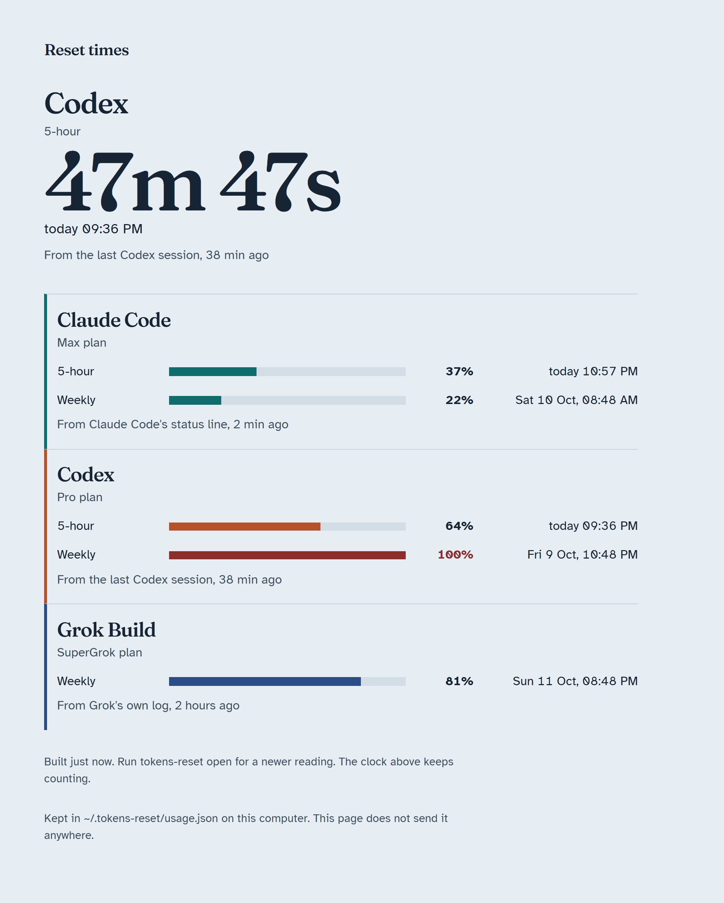

# tokens-reset

How much of each coding CLI's plan you have used, and when it resets. One command, for Claude Code, Codex, and Grok Build.

```text
$ tokens-reset
Next reset: Codex, 5-hour, in 47m 59s (today 21:36)

Claude Code  Max
  5-hour  ███████░░░░░░░░░░░░░   37%  resets in 2h 08m (today 22:57)
  Weekly  ████░░░░░░░░░░░░░░░░   22%  resets in 3d 11h (Sat 10 Oct, 08:48)
  From Claude Code's status line, 2 min ago

Codex  Pro
  5-hour  █████████████░░░░░░░   64%  resets in 47m 59s (today 21:36)
  Weekly  ████████████████████  100%  resets in 3d 1h (Fri 9 Oct, 22:48)
  From the last Codex session, 38 min ago

Grok Build  SuperGrok
  Weekly  ████████████████░░░░   81%  resets in 4d 23h (Sun 11 Oct, 20:48)
  From Grok's own log, 2 hours ago
```

## Everything stays on your computer

- **It only reads local files.** The numbers come from logs and data your CLIs already keep on your disk.
- **It makes no network calls.** There is no server, no account, no telemetry, and no API key. Nothing is uploaded and nothing is exposed.
- **It never opens your logins.** It does not read `auth.json`, `.credentials.json`, API keys, or OAuth tokens.
- **It uses no tokens.** Checking your usage does not spend any of it.
- **It has no dependencies.** It is under 2,000 lines of plain Node.js, with no networking code in it, and you can read it before you run it.

It keeps the plan name, the percent used, and the reset time in `~/.tokens-reset/usage.json`. It does not keep prompts or anything else from the logs.

## Install

You need [Node.js](https://nodejs.org) 20 or newer, and git.

```bash
npm install -g github:TamerinTECH/tokens-reset-dashboard
tokens-reset
```

Codex and Grok Build show up at once. To add Claude Code, run this one time:

```bash
tokens-reset setup
```

Then send one message in Claude Code and run `tokens-reset` again.

### Without installing

Clone it and run it in place. There is no build step:

```bash
git clone https://github.com/TamerinTECH/tokens-reset-dashboard
cd tokens-reset-dashboard
node bin/cli.js
node bin/cli.js setup
```

In a clone, read every `tokens-reset` on this page as `node bin/cli.js`.

For a quick look, `npx github:TamerinTECH/tokens-reset-dashboard` works too. `setup` needs one of the two installs above, because it writes this folder's path into Claude Code's settings.

## Connect your CLIs

| CLI | What you do | Where the numbers come from |
| --- | --- | --- |
| Codex | Nothing | The `rate_limits` object Codex writes into `~/.codex/sessions` each time it counts tokens. |
| Grok Build | Nothing | The `billing: fetched credits config` line Grok writes into `~/.grok/logs/unified.jsonl`. |
| Claude Code | `tokens-reset setup`, once | The `rate_limits` field Claude Code passes to its status-line command. |
| Anything else | `tokens-reset report ...` | You type the numbers. See [Another CLI](#another-cli). |

Codex and Grok Build are re-read from their logs on every run. A reading is as fresh as the last time you used that CLI, and each row says how old it is. If you moved their folders, `CODEX_HOME` and `GROK_HOME` are respected.

### Claude Code

Claude Code writes its limits nowhere on disk. It hands them to its status-line command, for Pro and Max, after the first response in a session. `setup` points the status line at a small script in this repo that stores them. The status line runs on your computer and its output never reaches the model.

```bash
tokens-reset setup --dry-run   # say what would change, change nothing
tokens-reset setup
```

This sets `statusLine` in Claude Code's `settings.json` and keeps a copy of the file next to it as `settings.json.before-tokens-reset`. It changes nothing else.

- **You already have a status line.** It keeps running. The script stores the limits and passes the same data on to yours:

  ```json
  "command": "node \".../adapters/claude-statusline.mjs\" --tee | bash ~/.claude/statusline.sh"
  ```

- **You have none.** You get one row, such as `5-hour 23.5% resets today 18:40   Weekly 41% resets Thu 8 Oct, 19:00`.
- **You use more than one Claude profile.** `setup` connects `~/.claude`, and the folder in `CLAUDE_CONFIG_DIR` when that is set. Each profile can be a different account, so each gets its own row, such as `Claude Code (work)`. Name other folders with `--claude-dir <folder>`.

`tokens-reset setup --undo` puts your own status line back. To do it by hand, the snippets are in [config/](config/).

### Another CLI

Report it and a row appears:

```bash
tokens-reset report --id cursor --name Cursor --plan Pro \
  --window id=monthly,label=Monthly,used=20,limit=100,unit=percent,resetsAt=2026-11-01T00:00:00Z
```

`unit` is `percent`, `tokens`, or `credits`. `resetsAt` is an ISO time or unix seconds. Omit a number you do not have.

```bash
tokens-reset report --json reading.json
tokens-reset report --forget cursor
tokens-reset report --example    # sample numbers, marked as examples
tokens-reset report --clear
```

If the CLI keeps its limits in a file, a small reader can pick them up automatically. See [docs/adding-a-cli.md](docs/adding-a-cli.md). Pull requests for more CLIs are welcome.

## Commands

| Command | What it does |
| --- | --- |
| `tokens-reset` | Print every plan window: how full it is and when it resets. |
| `tokens-reset --json` | The same as JSON, for a script. |
| `tokens-reset open` | Build the dashboard page and open it in the browser. |
| `tokens-reset setup` | One time: connect Claude Code. |
| `tokens-reset setup --undo` | Take that connection out again. |
| `tokens-reset report ...` | Record a reading by hand. |

`tokens-reset help` lists the options.

## The dashboard



`tokens-reset open` writes one self-contained file, `~/.tokens-reset/dashboard.html`, and opens it from disk. The large time is the next reset across every CLI, and it keeps counting. The readings are baked into the file, so run the command again for newer ones. Nothing keeps running in the background and the page loads nothing from the internet.

A reset time that has already passed stays on the board, marked as waiting for a newer reading. The tool does not guess a fresh zero. It shows the windows that were actually in the reading, so a plan with only a weekly limit shows only a weekly row.

## Optional: ask from inside a session

```bash
tokens-reset setup --mcp
```

This also registers a small local MCP server in Claude Code, Codex, and Grok Build, through each CLI's own `mcp add` command. A session can then answer "when do my limits reset?" or "which CLI still has room?".

It is off by default because a registered tool is sent to the model in every session, which costs a few tokens each time. This one is kept small on purpose: one read-only tool, `list_resets`, with a short description and an answer of one line per CLI. The server talks to the CLI over stdin and stdout and opens no port. Leave it out if you only look at the terminal or the page. `setup --undo` removes it.

## Uninstall

```bash
tokens-reset setup --undo
npm uninstall -g tokens-reset-dashboard
```

Delete `~/.tokens-reset` to remove the stored readings too. `TOKEN_RESET_HOME` moves that folder if you want it somewhere else.

## Develop

```bash
node --test
```

The tests build their own Codex, Grok, and store folders in the temp directory. They do not read yours.

| Path | Role |
| --- | --- |
| `bin/cli.js` | The `tokens-reset` command. |
| `adapters/claude-statusline.mjs` | Claude Code status-line command. |
| `lib/codex.js`, `lib/grok.js`, `lib/claude.js` | Turn each CLI's own data into a report. |
| `lib/collect.js` | Runs the readers that have a log to read. |
| `lib/store.js` | The JSON file: lock, validate, merge. |
| `lib/terminal.js`, `lib/page.js` | The board as text and as one HTML file. |
| `lib/setup.js` | `setup` and `setup --undo`. |
| `bin/mcp.js` | The optional stdio MCP server. |
| `public/` | Page source: CSS, script, fonts, and the clock math. |

[AGENTS.md](AGENTS.md) has the rules for changing the code.

## License

[MIT](LICENSE). The typefaces in `public/fonts/` are Fraunces and Atkinson Hyperlegible, both under the [SIL Open Font License](public/fonts/OFL.txt).
